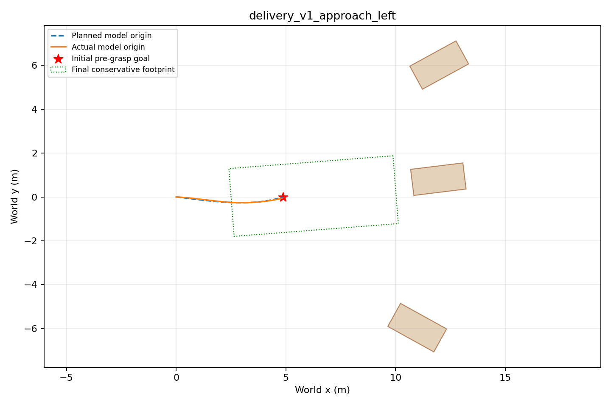
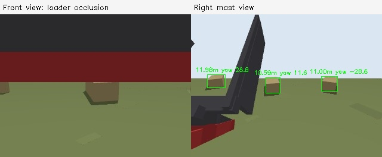

# First RGB-D autonomy delivery — 2026-10-19

The delivered baseline records synchronized RGB-D/state data, estimates a square
bale pose, combines viewpoints and repeated measurements, plans an approach,
and stops at a pre-grasp pose. Three modest approach cases passed; a larger
reversing maneuver failed safely. This is a measured simulation baseline, not
general autonomous bale handling or a validated real-world perception system.

## Artifacts

- Runner: [`scripts/bale_autonomy.py`](../scripts/bale_autonomy.py)
- Setup, schema, frame conventions and limits: [autonomous_approach.md](autonomous_approach.md)
- Versioned scores and collection metadata: [autonomy_results.json](autonomy_results.json)
- Local raw data: `datasets/delivery_v1*/`
- Local generated report and standalone plots: `runs/delivery_v1/`

The final delivery contains **560 paired RGB/depth observations across 11
trials**, using approximately **23.3 MB**. Six stationary collection scenarios
provide 162 observations; four approach trials and one deliberate sensor-loss
trial provide the rest. Development/pilot data is retained separately. All raw
datasets together occupy about 59 MB, well below the 20 GB cap; no data was
deleted to make room. The virtual environment is separate from that dataset cap.

## Approach outcomes

All navigation inputs came from camera/depth and wheel-speed/ideal IMU state
estimation. Simulator poses were used only as labels for scoring. Goals below
are pre-grasp stopping poses, not bale centers or pickup positions.

| Case | Bale x/y/yaw (m, m, rad) | True goal error | Heading error | Minimum SAT gap | Outcome |
|---|---|---:|---:|---:|---|
| Nominal | 12 / 0 / 0 | 0.111 m | 0.41° | 0.856 m | Passed |
| Left offset | 12 / 0.8 / 0.12 | 0.087 m | 2.43° | 0.806 m | Passed |
| Reserved right offset | 11.8 / −0.7 / −0.10 | 0.088 m | 0.21° | 0.836 m | Passed |
| Larger maneuver, seed 0 | 11.91 / −0.69 / −0.32 | 3.884 m | 51.16° | 4.587 m | Target lost; stopped and aborted |

Acceptance requires true position error <0.30 m, heading error <8°, and
conservative separating-axis gap >0.20 m. The footprint includes the open grip
and steering tire envelope. SAT gap is not exact Euclidean clearance. These
four hand-specified/design cases are too few to establish a general success rate.

The larger maneuver remains a concrete limitation: bounded planning found a
forward/reverse route, but tracking and camera visibility were insufficient to
complete it. It is retained in the data/report rather than excluded from the
results. Better view-aware tracking and wheel-slip correction are the next
navigation priorities.

## Occlusion and fusion evidence

The side-mast camera was moved higher and farther out after the initial
training trial showed that both the original front and side views could be
partially blocked. The final mount complements the front view; it does not
guarantee visibility at every loader angle.

In the reserved dry-ground/raised-loader case (seed 303), the front-only replay
provided a target pose within 0.30 m / 8° at **19%** of recorded timestamps.
The two-view replay provided one at **95%**. The other two reserved stationary
cases had valid target estimates at **100%** of timestamps. End-of-collection
records can contain only one camera exposure; availability uses the actual
recorded timestamps, including those partial final records.

In that occlusion case the accepted fused updates had mean position error
**0.043 m** on clean data and **0.058 m** with 2 cm Gaussian depth noise and
15% missing depth pixels. Noisy mean axis-yaw error changed from **2.43°** for
the selected single-frame candidates to **0.67°** for accepted fused updates.
Single-frame candidates included a wrong-bale outlier of about 5.7 m; track
association rejected it. Fused errors are conditional on accepted updates and
must be considered together with availability, not interpreted as perfect
continuous tracking. Smoothing did not improve every metric in every trial.

The detector still uses a broad straw-color cue plus known-size top-face
geometry. Similar ground colors are included, but the scene has simple box
bales, a flat field and ideal calibration. It does not demonstrate robustness
to real straw, complex clutter or arbitrary object dimensions.

## Failure handling and verification

- Deliberately removed visual measurements after 6 simulation seconds.
  The controller commanded stop once observations became stale, then aborted
  after the loss timeout. The separate `safety_stop_pass` check passed; this
  trial is not counted as an approach success.
- Thirteen analytic/message/frame/recording tests and the existing hydraulic CTest passed.
  Checks include RGB/depth stride, invalid depth, tilted-camera geometry,
  target association during turning, rear-axle integration and path collisions.
- Actual headless rendering used an RTX 3090. No GPU drivers or system graphics
  permissions were changed.
- Gazebo's existing allocator error persisted during shutdown. All final
  trials required forced process-group cleanup (`shutdown_status=-9`); this
  remains an environment/runtime issue to resolve separately from motion scores.

The next deliverable should expand autonomous maneuvering coverage, add
localization/visibility stress tests, and then connect pre-grasp alignment to
automatic gripping. The recorder's explicit frames, labels and calibration are
intended to support a later Unreal sensor adapter without changing the scoring
interface.
