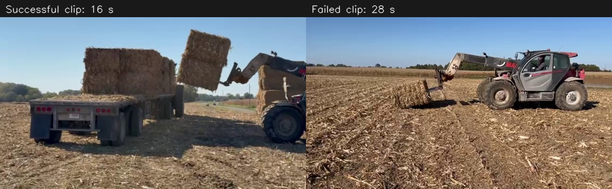

# Field video observations — 2026-10-21

These observations are from the two local videos supplied by the user, reviewed
through timestamped overview frames and closer samples around lifting and release.
Times below refer to encoded video time; playback speed has not been independently
verified. No physical forces, friction coefficients or insertion depths were measured.
Implementation files were not changed for this review.

| Clip | Local source | Duration / encoded rate | Visible outcome |
| --- | --- | --- | --- |
| Successful | `/home/zhihao/Downloads/ea60b0a8d03cbb8bc6b55edd93a14dad.mp4` | 43.63 s / 30 fps | Load lifted from trailer, moved to ground stack, placed, implement withdrawn. |
| Failed | `/home/zhihao/Downloads/c80b403085bb450bff7f501117d3c20b.mp4` | 35.87 s / approximately 30 fps | Ground-bale attempt includes partial lifting/tilting; no completed retained pickup and carry is shown. |

Both clips are 568 × 320 pixels. Source SHA-256:

- Successful: `b23180dd19a3c0601f987ebf78602a03ffe3782578ec391775d3534999a0ea1d`
- Failed: `ab589540066c9686bb904330e42e11da681f2a17fd3168bb575408a3dd2a19b8`

Original videos remain in Downloads; they were not copied into the repository.

## Observations and limits

In the successful clip, approximately 8–12 s shows engagement at the trailer;
12–19 s shows separation from the deck and a retained load while the implement
tilts and moves away. Around 28–43 s, the load is placed on the ground stack
and the implement withdraws. No large change in overall bale shape is obvious
at this resolution. Local straw displacement, damage and compression cannot
be excluded.

In the failed clip, approach/contact and implement adjustments precede the
clearest partial tilt around 24–29 s. One end rises while the opposite end stays
near the ground; the bale does not become a securely carried load. Later frames
show it back near a level ground-supported position with the implement moving
clear. The spear tips inside the bale are hidden, so the images do not establish
whether penetration was shallow, angled, under the bale, or otherwise poorly
distributed. Camera motion and perspective prevent a reliable metric estimate
of bale displacement from these sampled frames.

The user clarified that the trailer deck should be treated as a supporting
surface comparable to the ground. Both provide support and resistance to sliding.
The trailer pickup is a useful handling reference. Different surface friction
or neighboring contact may affect an attempt, but these clips do not isolate
those effects and should not be used to assign the failure to surface type.

## Implications for the next spear model

### Operator interpretation supplied after the visual review

The user identifies the failed attempt as an incorrect entry angle/boom setting:
the large boom should be lowered slightly to develop more ground resistance so
the implement does not push the bale away. This is operator-provided context,
not a force measurement extracted from the images. It supersedes treating the
failure as an entirely unexplained engagement problem.

The corresponding physical hypothesis is that lowering changes entry geometry
and, where contact transfers downward load into the bale, increases the support
normal force. Available sliding resistance then increases with that normal
force. An upward component can instead unload the support. Lower boom position
alone must not trigger an arbitrary friction increase: the model needs the
appropriate contact forces, their equal/opposite implement reactions, and
actual ground/deck support. The amount of lowering, force and allowable angle
remain unmeasured.

1. Retaining a rigid overall bale shape is a reasonable first modeling hypothesis
   for these maneuvers. The footage does not establish that material deformation
   is absent or irrelevant to penetration forces.
2. Pre-cut collision channels create an artificial alignment requirement. They
   should not be treated as evidence that a real spear must find a hole. A custom
   interaction should permit entry through a region of the bale face, with
   bounded axial resistance and equal/opposite implement and bale reactions.
3. Entry resistance and embedded transverse support need separate laws. A model
   can permit relatively easy axial entry while developing support as the shaft
   engages the material. The required strengths remain to be calibrated.
4. Partial engagement must allow rotation and ground contact. The failed clip
   supplies a qualitative target for a moment-driven tipping failure, rather
   than an automatic attached/not-attached transition.
5. Include the user's boom-lowering correction as a validation case. Ground/deck
   friction can restrain sliding while applied forces also produce a turning
   moment. Reproduce the effect of entry geometry and downward load on sliding
   and tipping, rather than assigning friction solely from boom position.
6. Retention checks should include whole-bale clearance, orientation, slip and
   sustained support. Center-height rise alone can misclassify a tipped bale.
7. Release should leave the placed load supported while the spears withdraw.
   Support must weaken continuously with withdrawal, rather than rely on a weld
   or a universal insertion-percentage success switch. The existing 60% test
   target is not established as a physical threshold by these videos.

## Proposed validation cases

- Aligned entry: measure bale translation/rotation during insertion and avoid
  arbitrary pre-existing holes. Match the qualitative retained-lift behavior.
- Entry-angle, height and depth variations: look for partial support, tipping,
  sliding and pullout, rather than prescribing one universal failure boundary.
- Operator correction: compare the failed boom/entry setting with a slightly
  lowered boom. Record downward contact load, ground/deck normal reaction,
  bale displacement and penetration; the corrected case should improve entry
  when the resulting forces provide sufficient resistance to sliding.
- Placement and withdrawal: verify support transfer and load remaining in place.
- Ground/deck friction sweep: evaluate sliding separately from penetration and
  tipping, without assuming the two surfaces have identical coefficients.

Exact force curves, material coefficients, tip geometry, real insertion depth
and mass distribution cannot be inferred from these clips alone. The user's
angle/boom-setting explanation supplies causal context that the images alone
did not establish. The footage provides behavioral validation targets, not a complete
parameter calibration. Preserve the tractor platform; use the shown equipment
as an interaction reference rather than replacing the tractor's loader model.
