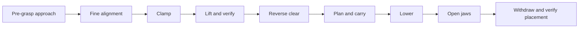
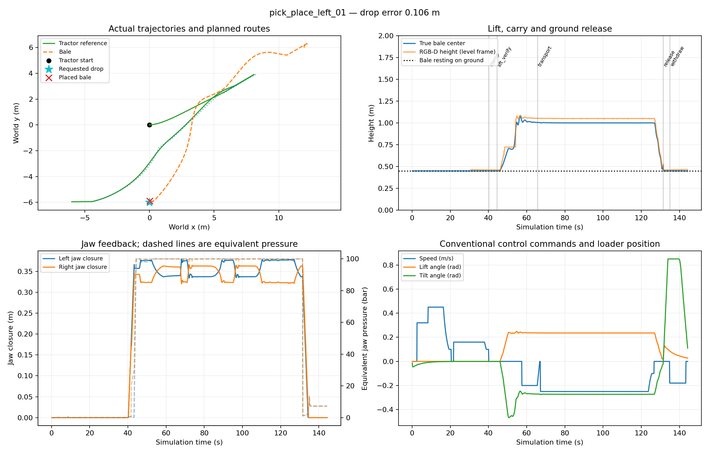

# Contact-based pickup and placement to the tractor's right

The task is now: approach a selected bale, clamp it, verify pickup, carry it to
the ground drop zone at **(0, −6) m**, lower, open the grip, and withdraw. The
initial tractor faces +X; −Y is its right. This is ground placement, not stacking.

## Run it

```bash
# Headless end-to-end test; default source is the center bale at (8.5,0).
.venv/bin/python scripts/bale_autonomy.py pick-place --name placement_01

# Watch the task, with live path and drop-zone markings.
.venv/bin/python scripts/bale_autonomy.py pick-place --gui --show-path --keep-open --wait-for-start

# Use the left-hand second bale in the earlier demonstration's layout.
.venv/bin/python scripts/bale_autonomy.py pick-place --bale 2 --target 12 .8 .12 --gui --show-path --keep-open --wait-for-start

# Isolate the pickup and load-verification stage.
.venv/bin/python scripts/bale_autonomy.py pick-place --stop-after-pickup --name pickup_01
```

`--drop X Y YAW` changes the destination. Its position is the desired **bale
center on the ground**, not the tractor's stopping position. Default yaw is 0.
The generated tractor goal accounts for the bale's measured offset within the
attachment and the change in reach when lowering. Use unique trial names;
automatic names are timestamped. The normal manual scene is unchanged.

Colors: **blue** planned route, **green** driven estimate, **yellow** current
tractor stopping pose, **magenta** source bale, **cyan** ground drop zone. The
drawings have no collision geometry. The GUI stays open for inspection when
`--keep-open` is supplied; close it or press Ctrl-C to stop that isolated trial.

## Controller sequence



Fine alignment moves the open grip around the bale at up to 0.16 m/s. The
selected payload is intentionally excluded from the broad tractor collision
rectangle during insertion/contact; other observed bales remain obstacles.
The existing grip model supplies contact and friction: no fixed attachment,
teleportation, or direct force on the bale is introduced.

Closure is accepted only when **both** jaws stop against an object away from
their travel limits and exceed the simulation's contact-effort threshold.
Clamping then goes neutral, retaining hydraulic holding effort. The controller
raises the boom to approximately 0.25 rad using a slow metered command and
controls tilt to keep the attachment approximately level. Transport waits for
an elevated bale observation and sufficiently steady attachment orientation.

The load monitor uses calibrated RGB-D geometry near the grip, independently
of the ground-bale detector. It compares measured bale position with the
position predicted from lift angle, tilt angle and the initially measured
grip-to-bale offset. Attachment rotation is included: a commanded tilt is not
automatically labeled as slipping. A missing observation or excessive relative
movement stops transport. The trace records jaw contact, visual availability,
relative position error and a conservative `carrying_verified` indicator.

Loaded transport uses forward/reverse Ackermann planning, a larger **6.2 m
front envelope** for payload overhang, and a 0.25 m/s speed cap. The driver
retreats clear before planning the loaded route. During planning it commands
zero drive; neutral hydraulic control retains the grip and boom position.

At the destination, the controller lowers slowly, checks that the observed
bale is near ground level, opens both jaws, reverses at least 1.5 m, and checks
the released bale again. The visual search region expands during withdrawal
so it continues to cover the bale after leaving the grip. The current ground
check is a geometric height proxy, not a dedicated ground-contact sensor.

## Evidence and acceptance

Recordings and source snapshots remain under `datasets/<trial>/`. In addition
to the ordinary RGB/depth, state and separate ground-truth records, these runs
write:

- `pick_place_events.json`: phase changes and clamp/lift evidence.
- `manipulation_plan_*.json`: fine-alignment and loaded-transport paths.
- `trajectory.jsonl`: commands, jaw/loader feedback, payload observations and
  inferred load evidence throughout the task.
- `approach.json` and, in current runs, `pick_place.json`: task outcome.

Simulator object poses are used only by the scorer, not by the controller.
Full-task acceptance requires a verified pickup, successful release/withdrawal,
final bale-center error below **0.6 m**, final height within **0.15 m of 0.45 m**,
and conservative separation above **0.20 m from the other bales**. Intended
grip/payload contact is excluded from that collision score. These are baseline
simulation tolerances, not real-machine accuracy or safety ratings.

The storage guard remains the smaller of 20 GB and 40% of disk capacity, with
at least 5 GB free. Bales are still rigid boxes of assumed dimensions and mass.
No reinforcement learning, neural inference, new hydraulic force limits, or
photorealistic scene assets are required by this task.

## Recorded end-to-end results

Both final trials completed pickup, loaded transport, ground release and
withdrawal. The destination was (0, −6) m in both cases.

| Source | Final position error | Final yaw error | Task simulation time | Acceptance |
| --- | ---: | ---: | ---: | --- |
| Center bale at (8.5, 0) m | 0.241 m | 0.88° | 143.5 s | Pass |
| Second/left bale at (12, 6) m | 0.106 m | 0.48° | 144.4 s | Pass |

Both bales settled with their centers 0.45 m above ground. The conservative
minimum separation from the other bales was 0.99 m and 1.28 m, respectively.
These two cases establish a working baseline; they do not establish reliability
across terrain, lighting, bale deformation or sensor failures.

The trials recorded 1,680 RGB-D pairs in total. Numerical results are in
[pick_place_results.json](pick_place_results.json); the raw trials are
`datasets/pick_place_delivery_01/` and `datasets/pick_place_left_01/`.
The latest estimated-position placement guard was additionally checked against
their recorded final observations (estimated errors 0.028 m and 0.151 m).



Gazebo still encounters the existing allocator/teardown problem after these
completed trials; shutdown required forced process cleanup (`shutdown_status:
-9`). Task acceptance is recorded separately from shutdown status.

## Connection to real load sensing

The simulation's jaw effort/pressure, position and RGB-D observations provide
complementary evidence. High clamp pressure alone can also occur at an end
stop or against the wrong object; it does not prove a retained payload.

Real loader weighing systems can use hydraulic pressure and lifting-arm angle;
for example, the manufacturer-authored [LOADRITE L3180 manual](https://sitechnw.com/download/4495/?tmstv=1685741679)
describes pressure transducers and angle sensors. Application to this tractor
would require calibration, empty-attachment compensation and confirmation of
available sensors/CAN signals. Load pins are another possible force-sensing
interface to investigate. We have not established that the real tractor already
exposes any of these signals.

Payload weight and grip retention are different questions. A real grip should
combine appropriate jaw feedback with an independent retention check and use
the implement manufacturer's permitted settings. The simulation's equivalent
100 bar jaw cap is an existing modeling assumption, not a pressure recommendation
for real bales or the real attachment.
