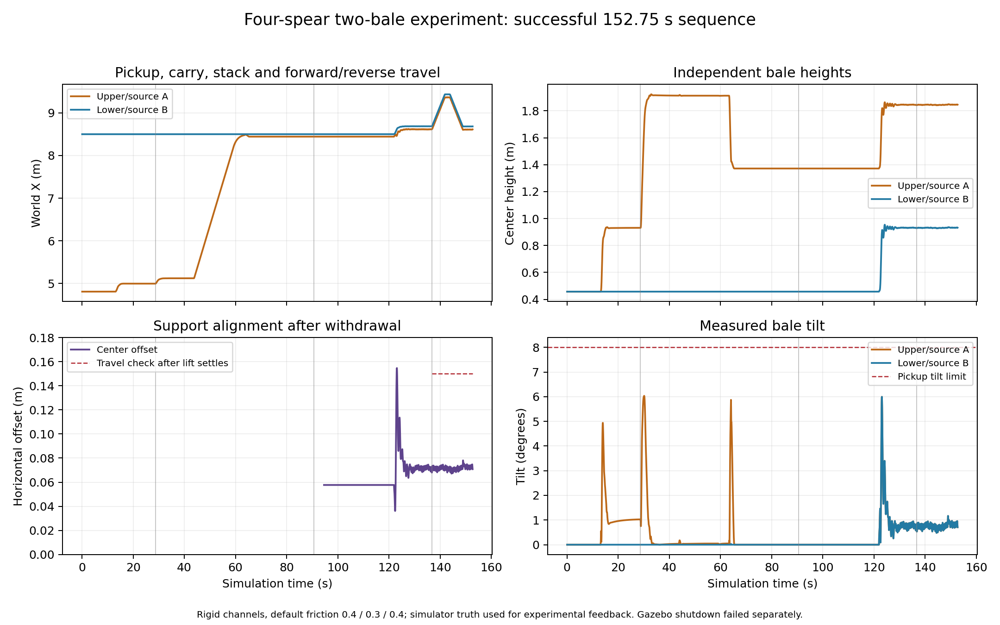

# Archived channel-based spear prototype

This records the earlier channel-based implementation. To run that baseline,
pass `--config spear_handling/config_channels.json`. The default config now
uses the solid-bale material model described in `spear_material_model.md`.

# Tractor bale spear project

This is a separate development project for the requested four-spear attachment
and two-bale handling sequence. It reuses the existing tractor and L115-inspired
loader in `../worlds/simple_tractor.sdf`; it does not replace the jaw-grip demo.

## Current status — 2026-10-21

Aligned pickup and the complete two-bale sequence now have successful recorded
physics trials. The runner measures all four finite shafts in bale coordinates
from explicit, synchronized world poses. It gates insertion before lifting,
checks pickup height, whole-bale ground clearance, tilt and retention, and stops
if insertion pushes the bale more than 0.15 m. The original failed trial A is
retained as historical evidence.

The sequence picks A, places it on B, withdraws completely, inserts into B,
lifts both separate bodies, then drives forward, brakes, reverses and holds.
There are no attachment joints or direct bale forces in the default mode.
Shallow insertion and a 12 cm lateral offset fail the pickup checks; the latter
is rejected before lifting. These are bounded channel-model experiments, not
validation of real straw or sensor-based autonomy.

All nine controlled pair-friction checks passed. With individual pair settings
permuted across three fixtures, measured sliding recovered mu approximately
0.100 and 0.200; mu 0.600 prevented sliding against a horizontal gravity ratio
of 0.300. Fixture surfaces retain SDF mu 0.900, demonstrating that the callback
overrides affect motion. Material coefficients still require calibration.

Task completion and process shutdown are separate: Gazebo teardown still
produces allocator errors or signals. Small reviewed numerical summaries are
in [spear_results.json](../docs/spear_results.json); full raw worlds, trajectories,
reports and source snapshots remain git-ignored under `runs/spear_*`.
See [HANDOFF.md](../HANDOFF.md) for the resumption record and remaining work.

From the repository root:

```bash
cmake -S spear_handling -B spear_handling/build -DCMAKE_BUILD_TYPE=RelWithDebInfo
cmake --build spear_handling/build -j 2
python3 spear_handling/validate.py --case A
```

Use system Python with Gazebo bindings. The runner uses an isolated partition
and simulator truth for experimental control. Other commands:

```bash
python3 spear_handling/validate.py --case B
python3 spear_handling/validate.py --case C
python3 spear_handling/validate.py --case sequence
python3 spear_handling/check_friction.py
python3 tests/test_spear_geometry.py
```

`--gui` is available on `validate.py` but was not exercised in these trials.
B/C return nonzero when pickup fails; a sensitivity experiment executing is
not automatically a successful pickup. The default sequence uses the configured
transport speed of 0.15 m/s. `check_friction.py --check-teardown` compares
fixed-iteration Gazebo shutdown with and without the custom plugin.

The final recorded sequence took **152.75 simulation seconds**. During
forward/brake/reverse/hold, the largest center offset was **0.0781 m**, maximum
layer-height error **0.00140 m**, and maximum bale tilt **1.17°**. The lower bale
remained at least **0.463 m** clear of the ground. These observations describe
this trial; channel clearances and timestep have not yet been swept.



## Inspection completed

- Installed Gazebo Sim: 8.15.0; gz-physics: 7.8.0; DART: 6.13.2;
  SDFormat: 14.9.0.
- Reusable loader chain: `chassis -> loader_mount -> loader_boom ->
  attachment_carrier`. Keep `loader_lift_joint` and `attachment_tilt_joint`.
- Reuse `../src/LoaderHydraulics.cc` and `../src/HydraulicModel.hh`, their
  independent valve topics, joint feedback, timeouts, shared flow allocation,
  force limits, and PID servo with anti-windup.
- Existing lift limits: 0–1.44 rad, 0.20 rad/s; tilt limits: -0.65–0.85 rad,
  0.35 rad/s. Preserve the source effort limits and hydraulic configuration.
  The existing pressure/cylinder values are documented engineering assumptions,
  not measured L115 specifications.
- Existing fork fixture: `../tests/fixtures/square_bale_fork.sdf`. Its two
  1.3 m tines support a prepositioned bale; it does not validate penetration.
- Existing production bales are 2.4 x 1.2 x 0.9 m, 525 kg solid boxes. They
  need a separate configurable geometry for this project's field estimates.
- Existing recording, isolated Gazebo partitions and hydraulic test utilities
  can be reused. Jaw-grip pickup success does not validate spear pickup.

## Design and implementation notes

1. Generate a separate world from the baseline tractor. Replace the jaw
   attachment with a four-spear carrier and remove its unused jaw actuation.
   Recalculate attachment mass and inertia. Preserve tractor motion, loader
   joints, hydraulic limits and existing command interfaces.
2. Generate independent dynamic bales from configurable dimensions and mass.
   Start with length 2.4384 m, width 1.2192 m, height 0.9144 m and mass 200 kg.
   Compute uniform-box inertia analytically from those values, independent of
   the collision-channel void volume. These are preliminary field estimates;
   450 lb is approximately 204 kg, so 200 kg remains a rounded initial value.
3. Mount four spears across a 1.9 m frame, at lateral positions approximately
   -0.85, -0.2833, 0.2833 and 0.85 m. Initial exposed length: 1.0 m; shaft
   diameter: 0.04 m. Current collision and visual shafts are blunt cylinders; a tapered tip remains future work. These are adjustable engineering
   starting values, not manufacturer dimensions or structural ratings.
4. Approach the 8 x 3 ft long side of an upright bale. The four spears run
   across the tractor's lateral axis and penetrate the 1.2192 m bale width.
   A 60% insertion target is then 0.7315 m. If the bale is rolled onto its
   other long face, insertion thickness becomes 0.9144 m and the same target
   becomes 0.5486 m. Compute penetration from geometry rather than a fixed
   distance or an automatic successful-grasp threshold.
5. First evaluate four hidden, open-ended internal channels built from compound
   convex collisions on one rigid bale link. Retain full visual geometry and
   exterior ground/stack contact surfaces. Channel ceilings can supply upward support through actual collision contact;
   floors and walls constrain motion. No bale attachment
   joint is used in this first prototype.
6. Empty channels have no straw insertion resistance. Evaluate that baseline
   separately, then add a configurable, dissipative axial resistance model if
   needed. Apply equal and opposite forces to spear and bale at the engagement
   points, with depth/velocity dependence and force caps. It must not supply
   arbitrary upward lifting force. If channels cannot provide stable support,
   document and separately evaluate a bounded compliant engagement model with
   force/moment limits and release on withdrawal; never weld the upper bale.
7. Tying-band visuals are implemented. Straw texture remains future work.
   Visual changes do not alter collision geometry or inertial properties.

## Friction and major risks

- Configure bale-ground, bale-spear and bale-bale interactions independently.
  Per-surface SDF coefficients alone must not be presented as arbitrary
  independently selectable pair coefficients. Inspect DART's coefficient
  combination and validate the installed contact-property customization path
  before choosing how to implement pair-specific settings. Installed Gazebo
  headers expose contact-surface customization and gz-physics contact callbacks;
  the corrected scoped-name classification now produces recognized callbacks.
  The controlled sliding fixtures verify the overrides for all three pairs;
  shaft/contact geometry sensitivity remains a separate question.
- Channels impose artificial alignment and clearance tolerances, and their
  walls can create unrealistic mechanical retention. Sweep channel clearance,
  spear angle and timestep before treating successful lifting as meaningful.
- Thin spears may cause missed contacts, jitter or solver sensitivity. Start
  from the existing 1 ms step, and check convergence rather than hiding failures
  with large friction coefficients.
- Lowering and downward tilt increase ground friction only if actual contact
  produces additional normal load. Log contact forces and bale motion.
- Tractor drive currently uses wheel-velocity commands. It is not a calibrated
  engine/drivetrain traction model; successful insertion cannot establish real
  tractor pushing capability.
- Upper-bale stability must emerge from gravity and bale-bale contact. It stays
  a separate rigid body through placement, withdrawal, two-bale lifting and
  acceleration/deceleration.
- Exact insertion resistance, steel/straw friction, bale density distribution,
  real spear dimensions and hydraulic capacity require field calibration.

## Incremental validation

Run manual or scripted physical controls first, before adapting autonomous
perception and planning to long-side pickup. Record insertion depth, alignment,
joint state/effort, contact evidence and both bales' poses and velocities.
Simulator object poses are permitted as test measurements, not as evidence of
sensor-based autonomy.

| Scenario | Required observation | Status |
| --- | --- | --- |
| A: aligned, roughly 60% insertion | Single-bale pickup and hold; withdrawal in sequence | Pickup/hold passed; withdrawal completed in full sequence |
| B: shallow insertion | Reduced support, slip or rotation where physically warranted | Executed; pickup rejected, about 30° bale tilt |
| C: lateral/yaw/height error | Collision resistance and stability sensitivity | 12 cm lateral case rejected before lifting; yaw/height sweeps remain |
| D: stack and withdraw | Bale A rests independently on Bale B | Completed in recorded sequence |
| E: lift the lower bale | Both lift; upper bale has no attachment joint | Completed in recorded sequence |
| F: forward/reverse acceleration | Measure sliding, tipping and any loss of load | Bounded 0.15 m/s forward/brake/reverse completed |

Repeat critical cases with different integration steps and contact/friction
settings. Report failures as well as successes. Optional axial resistance is
implemented but disabled and untested. Channel voids, blunt shafts and fixed
stage heights remain approximations. Force measurement, broader misalignment
sweeps, timestep convergence and real-material calibration remain open.

## References inspected

- Local loader documentation: `../docs/loader_hydraulics.md`.
- Local physics assumptions: `../docs/physics_parameters.md`.
- Gazebo DART SDF adapter matching the installed release:
  https://github.com/gazebosim/gz-physics/blob/gz-physics7_7.8.0/dartsim/src/SDFFeatures.cc
- DART contact implementation matching the installed release:
  https://github.com/dartsim/dart/blob/v6.13.2/dart/constraint/ContactConstraint.cpp
