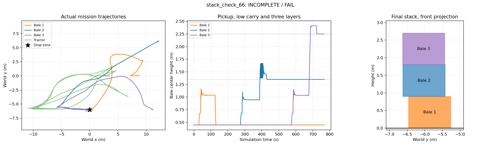

# Three-bale stack at the right-hand drop zone

The mission collects the center, left and right source bales, in that order,
and places them in one vertical stack at **(0, −6) m**. This is the same drop
zone used by the single-bale placement task. The first bale rests on the ground;
the other two rest on the previously placed bale. Nominal centers are 0.45,
1.35 and 2.25 m above ground.

## Run

From the project directory, with the autonomy environment and hydraulic plugin
already built:

```bash
.venv/bin/python scripts/bale_autonomy.py stack --gui --show-path --keep-open --wait-for-start
```

Arrange the Gazebo view, then press Enter in that terminal. The entire mission
runs in one isolated Gazebo simulation. Blue is the current planned route,
green is the driven estimate, magenta marks the current source, and cyan marks
the drop zone. No separate teleoperation terminal is needed. Close Gazebo or
press Ctrl-C when finished inspecting the scene.

For a recorded headless trial:

```bash
.venv/bin/python scripts/bale_autonomy.py stack --name stack_01
```

Use a unique name. The dataset storage guard retains the existing 20 GB / 40%
limit. The normal manual world and its hydraulic limits are unchanged.

## Sequence and sensing

Each cycle approaches a fresh camera-observed source, clamps using physical
contact, verifies lifting using jaw feedback and RGB-D motion, and transports
the bale low. After placement the tractor withdraws fully, lowers the empty
attachment and returns to its initial observation position for the next source.

For the second and third layers, low transport routes through a west-side
waypoint at (−11, −6) m, then replans from the stopped tractor to a staging
pose 3.4 m before insertion. The existing stack remains a collision obstacle
throughout low transport.
The cameras must observe a complete known-size support top near the estimated
drop location. Its measured center, height and orientation refine placement;
the controller does not read simulator object poses.

The tractor raises the load while stationary to approximately 0.20 m above
the requested layer, inserts at up to 0.10 m/s, lowers slowly, opens the jaws,
and reverses 3.4 m before lowering the empty attachment. During transport and
raised insertion, jaw contact and lift/tilt encoders bridge camera blind spots
using the pickup-calibrated jaw-to-bale offset. A fresh RGB-D view is still
required to verify the released bale. During raised insertion, the chassis is
checked separately from the implement's intended overlap over the support
stack. Nearby unrelated bales remain obstacles.

The third layer uses nearly the existing tilt travel limit of −0.65 rad. A
bounded inverse-kinematics calculation accounts for that limit and the measured
grip-to-bale offset. Side cameras can see the top face when the front camera is
below the raised bale. A missing support observation, loss of jaw contact,
excessive load displacement, unreachable height or failed post-release
observation stops the mission. These checks are geometric simulation proxies,
not real-machine safety certification or force-based support detection.

Travel and insertion use geometric feedback and pure-pursuit path following.
Lift uses proportional-derivative feedback with a small feed-forward term for
tilt compensation; there is no integral term. The hydraulic valve model has a
small-command deadband, so reset and fine lowering explicitly overcome it.

No fixed attachment joint, teleportation, direct bale forces, neural inference
or reinforcement learning is used. Bales remain rigid 525 kg boxes in the
existing contact/friction model. General deformable-bale stacking and uneven
terrain are outside this baseline.

## Recordings and acceptance

`datasets/<trial>/` contains synchronized RGB-D data, controller trajectories,
separate simulator labels and source snapshots. `cycle_1/` through `cycle_3/`
contain manipulation paths and phase/evidence logs. `stack_progress.json`
records completed placements as they happen. `stack.json` contains final
post-control scores, and `return_plan_*.json` records routes back for the next
source.

The mission waits after final placement before scoring. Acceptance requires:

- Three completed cycles, each with a verified pickup.
- Every bale center within 0.6 m of the requested drop location.
- Centers within 0.12 m of the three nominal layer heights.
- Adjacent layer centers aligned within 0.30 m horizontally.
- Final roll, pitch and axis yaw errors below 8 degrees.
- Conservative clearance above 0.20 m from unrelated bales and the stack's
  chassis exclusion region.

These are bounded test thresholds, not validated operating limits for a real
tractor. The known Gazebo teardown issue is logged independently of task success.

## Verified run

`datasets/stack_check_66/stack.json` records one complete three-pick, three-place
run. All pickups were verified and all three released layers were observed.
Ground truth gave center errors of **0.250 m**, **0.083 m**, and **0.426 m**;
height errors were below 1 mm. The neighboring layer center offsets were
**0.330 m** and **0.345 m**. Thus the mission completed physically, but the
recorded `acceptance_pass` is false because the original 0.30 m neighbor-center
limit is exceeded by 3.0 cm and 4.5 cm. The bales are vertically stacked,
with the third layer 0.426 m from the nominal drop center. The run used 768.5
simulation seconds and recorded 6,044 camera frames plus controller and
ground-truth trajectories. Gazebo teardown returned `-9` after the task had
completed and scored.



This is a conventional RGB-D/encoder/control baseline: it uses no learned model
or GPU inference. Saved simulator poses are used only for post-run scoring.
